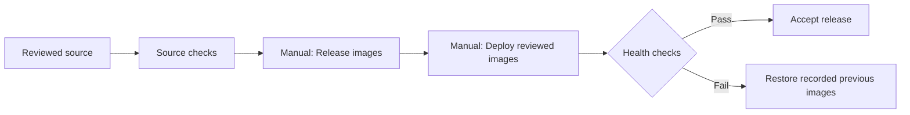
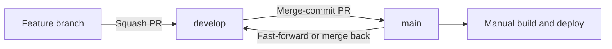

# Deploying USTW from GitHub

Frontend: [website](https://github.com/US-Taiwan-Watch/website). Payload CMS: [backend](https://github.com/US-Taiwan-Watch/backend), under `payload3/`.

`ustw.watch`, `www.ustw.watch` and `dev.ustw.watch` share one production frontend (`ustw-cms-frontend-dev`) and one CMS (`ustw-cms-backend`). The GitHub environment named **Development** is a legacy name for their release configuration; it is not a separate test website. **Build and deploy from `main`.**



## Normal release

| Step | What to do | Result |
| --- | --- | --- |
| 1 · Review | Merge checked changes. Website features go to `develop`; promote to `main` with a **merge commit**. Backend changes go to `master`. | Reviewed source; merging does not deploy |
| 2 · Build | Website → Actions → **Release images** → Run workflow → branch **main**. Select frontend, backend or both. For backend, supply the exact reviewed 40-character commit. | Packages published to the existing Azure registry; run summary and `release-images.json` contain their immutable `sha256:` digests |
| 3 · Deploy | Actions → **Deploy reviewed images** → branch **main**. Enter each selected new digest and its currently deployed digest. Type `DEPLOY USTW PRODUCTION`. Leave **verify_rollback** off. | GitHub signs in to Azure, verifies all previous-image inputs before changing either app, deploys backend first, checks it, then deploys/checks frontend |
| 4 · Accept | Confirm the run succeeded and check the feature affected by the release. Download `deployment-result-<run ID>` if needed. | Traceable release with exact source, versions and checks |

To find the currently deployed image, use Azure App Service → Configuration / Deployment Center, or:

```sh
az webapp config show -g ustw-cms-rg -n ustw-cms-backend --query linuxFxVersion -o tsv
az webapp config show -g ustw-cms-rg -n ustw-cms-frontend-dev --query linuxFxVersion -o tsv
```

Use only the `sha256:…` portion as a workflow digest input. The workflow fixes the registry, app names and repositories; tags or arbitrary URLs are rejected. Leave both digest fields empty for a component you are not deploying. If another release changed Azure after you recorded the previous versions, preflight fails before deployment; refresh the inputs.

## Rollback

| Situation | Action |
| --- | --- |
| Deployment or built-in health check fails | The workflow attempts to restore each attempted app to its recorded previous image, then verifies restored health. Check the restore steps; a failed workflow alone does not prove rollback succeeded |
| A later functional check finds a problem | Run **Deploy reviewed images** again. New digest = last known good version; previous digest = the version currently in Azure. Leave **verify_rollback** off |
| A restore step fails | Use the retained Azure operator access to restore the recorded image, then run health checks. Inspect the failed run and the current Azure image before retrying |

Built-in checks cover CMS health/disabled jobs and both public language homepages. They are smoke checks; test the specific behavior changed by a release separately.

**Application rollback does not rewind MongoDB or uploaded files.** These workflows change only app image selection and restart apps. Schema/data migrations require a separate compatible recovery plan. Never point the old Payload 2 backend at the migrated MongoDB 9 database. Bill/legislator updates and newsletters remain disabled.

<details>
<summary>Supervised verification of automatic rollback</summary>

Use this only for an intentional, authorized drill:

1. Record the currently healthy app digests as **previous** versions.
2. Select different, already accepted Payload 3-compatible images as the **new** versions. Confirm their registry artifacts still exist.
3. Run **Deploy reviewed images** with **verify_rollback** enabled.
4. Both selected apps deploy and pass health checks. The workflow then deliberately fails, exercising the same automatic restore path as a deployment failure.
5. Confirm both restore and restored-health steps passed, `rollbackVerified` is true in the receipt, and Azure points to the exact initial images. The run is intentionally **red**.
6. A normal run with verification off should succeed. Re-deploying the current digests is supported for checking that success path.

A drill requires different new/previous versions; reapplying the same version cannot establish that a real version switch was restored.

</details>

## Branches and source history



The November 3 repair links the previously unrelated `main` and `develop` histories with a normal merge. Both histories are retained. **Do not squash/rebase a develop-to-main promotion**: its merge commit preserves that connection. After promotion, fast-forward `develop` to `main` if no new work has landed; otherwise merge `main` back into `develop`. Never force-push either shared branch.

## Deployment access

| Item | Configuration |
| --- | --- |
| Azure sign-in | GitHub OIDC: short-lived sign-in, no stored Azure application password |
| Trusted job | `US-Taiwan-Watch/website`, environment `Development`; environment release policy allows **main only** |
| Identity | Microsoft Entra application **ustw-github-production-deploy** |
| Permission scope | Custom role **USTW app image deployer**, assigned separately to the two App Service resources; configuration read/write and restart. No secret-listing, storage or database permissions |
| Identity settings | Environment secrets `USTW_AZURE_CLIENT_ID`, `USTW_AZURE_TENANT_ID`, `USTW_AZURE_SUBSCRIPTION_ID`; these identify the federation and contain no application password |
| Build access | Existing registry credentials plus the existing public Algolia search key and server-only SoundOn token; build configuration is mounted as a temporary secret and removed |
| Runtime service credentials | Existing Azure app settings; this pipeline does not copy them into GitHub or images |

Password-based SCM publishing remains disabled for the backend. The old frontend publish profile is not used by this workflow. Existing automatic container webhooks stay off; the retired legacy workflow remains disabled.

<details>
<summary>Administrator reference and verification evidence</summary>

- Role definition: [`azure-role.json`](azure-role.json). Keep its assignments on the two individual app resources, not the whole subscription/resource group.
- Federation issuer: `https://token.actions.githubusercontent.com`; subject: `repo:US-Taiwan-Watch/website:environment:Development`; audience: `api://AzureADTokenExchange`.
- Keep the environment branch restriction aligned with `main`. Renaming that environment requires updating the federation subject.
- Tests: `node --test deployment/release-plan.test.mjs` checks immutable selection, explicit production confirmation, malformed input rejection, meaningful rollback drills and stale/intervening release protection.
**Verified November 3, 2026**

| Check | Evidence |
| --- | --- |
| Pipeline and branch-history repair | [PR #232](https://github.com/US-Taiwan-Watch/website/pull/232), merge `411eb36`; both original branch histories preserved and develop fast-forwarded to main |
| Source checks | [Passing main check](https://github.com/US-Taiwan-Watch/website/actions/runs/41652500166); local lint/types, five deployment guard tests and actionlint also passed |
| Real deployment + automatic rollback | [Supervised drill](https://github.com/US-Taiwan-Watch/website/actions/runs/41652639876): both prior accepted Payload 3 images deployed and passed health checks; intentional failure restored both exact starting images; both restored-health checks passed. Expected run conclusion: failure |
| Normal deployment | [Successful run](https://github.com/US-Taiwan-Watch/website/actions/runs/41653454559): both current images deployed via GitHub with verification off; CMS and public bilingual health checks passed |
| Independent Azure readback | Both original image digests restored; application settings and other app configuration unchanged. No database migration or media writes |
| Azure identity | No password/key credentials; one GitHub federation, exactly two app-scoped role assignments |

Recorded image digests at verification time (read current Azure images again before a future release):

| App | Image after verification |
| --- | --- |
| Payload CMS | `sha256:d30005190859997fe27721d84a74839b7601dafb0282f4dc29096c5f8d121ca2` |
| Frontend | `sha256:47db32eb8ac28334db6c1c8049cf9b561b2e4ead27b532ab91279d74fe40ed98` |

</details>
